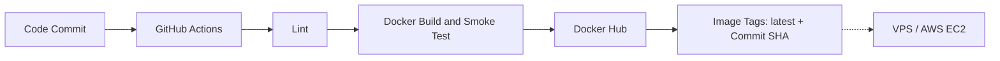

# DevOps Intern Screening Task

A minimal Flask application containerized with a multi-stage Docker build, published through GitHub Actions, alongside a Bash script for Linux system health monitoring.

- **Repository:** https://github.com/ahmedrafatcse/devops-intern-task
- **Docker Hub:** https://hub.docker.com/r/ahmedrafatdev/devops-task-app

## Prerequisites

- Git
- Docker with Compose v2 (`docker compose`); on older installs, use `docker-compose` instead
- curl (for testing the application)
- Bash and a Linux environment (for native execution of the health script)

## Run the application

Clone the repository and start the application:

```bash
git clone https://github.com/ahmedrafatcse/devops-intern-task.git
cd devops-intern-task
docker compose up --build
```

The application listens on port `8080`. Test it in a second terminal:

```bash
curl http://localhost:8080
```

Expected response:

```json
{"message":"Hello from DevOps Intern Task!","status":"running"}
```

`docker compose up --build` runs in the foreground; press `Ctrl+C` to stop. Stop and remove the container with:

```bash
docker compose down
```

## System health monitoring

`system_health.sh` appends timestamped CPU, memory, and disk usage metrics to `health_log.txt`. It prints a warning when disk usage exceeds the default threshold of 80%.

Run the script on Linux:

```bash
chmod +x system_health.sh
./system_health.sh
```

The script uses `/proc/stat`, `/proc/meminfo`, and `df` to retrieve system metrics. It requires Bash, so run it using `./system_health.sh` or `bash system_health.sh`, not `sh system_health.sh`.

On Windows, run it inside a Linux container using PowerShell:

```powershell
docker run --rm -v "${PWD}:/work" -w /work ubuntu:24.04 bash /work/system_health.sh
```

This reports the Linux container's metrics, not native Windows host metrics.

The disk threshold and log output path can be customized using the `DISK_THRESHOLD` and `LOG_FILE` environment variables.

### Sample output

Normal operation: metrics below the threshold, no warning:

```text
[2026-11-06 16:11:31] CPU: 0.2% | MEM: 19.9% | DISK: 1%
[2026-11-06 16:11:33] CPU: 0.6% | MEM: 20.0% | DISK: 1%
```

The threshold is a strict "greater than" comparison. To demonstrate the warning without waiting for real disk pressure, lower the threshold below the current disk usage:

```bash
$ DISK_THRESHOLD=0 ./system_health.sh
[2026-11-06 16:09:41] CPU: 0.3% | MEM: 19.8% | DISK: 1%
[WARNING] Disk space high!
```

`health_log.txt` is runtime output and is excluded from version control.

## CI pipeline and image publishing

Pushes to `main` and pull requests targeting `main` trigger `.github/workflows/ci.yml`.

The workflow contains two jobs:

1. **Lint:** Installs Python 3.13 and Ruff, then runs `ruff check .`.
2. **Build and publish:** Runs after successful linting, builds the Docker image, starts the container and performs an HTTP smoke test against `/`.

On pushes to `main`, the workflow authenticates with Docker Hub and publishes two image tags:

- `latest`
- The full commit SHA for version traceability.

Pull requests run validation only. Publishing is restricted to pushes to `main`.



The image is published to Docker Hub. Deployment to a VPS is conceptual and is not implemented in this repository.

## How would you deploy this container to AWS?

- **Provision an EC2 instance:** Use Ubuntu, install Docker and Compose, and configure security groups to allow SSH from a trusted IP and public traffic on ports 80/443. Keep application port 8080 behind a reverse proxy that handles HTTPS.
- **Deploy the image:** Pull the image from Docker Hub using its commit SHA rather than `latest`, ensuring the deployed version is traceable and rollbacks are straightforward. For private images, store registry credentials securely using AWS Secrets Manager or SSM.
- **Automate deployment:** Once manual deployment is verified, introduce a GitHub Actions deployment job over SSH to pull the updated image and restart the container, using its health check to verify application availability.